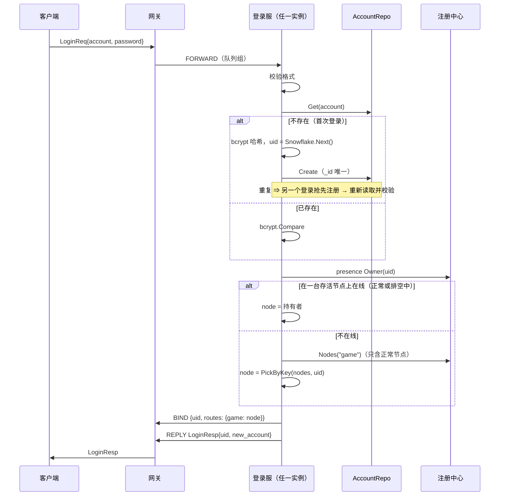

# loginsvc —— 登录服务

[English](README.md)

负责账号认证、分配 uid、为每个玩家分配游戏节点。它是**无状态**的：任何实例都能处理任何请求，
因此网关通过 NATS 队列组（`gs.svc.login`）对登录流量做负载均衡。

## 流程



## 规则

| 校验 | 错误 |
|---|---|
| 账号匹配 `^[A-Za-z0-9_]{3,32}$` | `ERR_INVALID_ACCOUNT` |
| 密码长度 6–64 | `ERR_INVALID_PASSWORD` |
| 密码与存储的 bcrypt 哈希匹配 | `ERR_WRONG_PASSWORD` |
| 会话尚未登录 | `BAD_REQUEST` |
| 至少注册了一个游戏节点 | `SERVICE_UNAVAILABLE` |
| 归属目录可读（读不到就拒绝） | `SERVICE_UNAVAILABLE` |

在线玩家总会回到持有它的那台节点，即使期间新增了节点、或那台节点正在排空；详见 [presence](../presence/README.zh-CN.md)。

## 并发

bcrypt 被刻意设计为 CPU 密集（cost 10 时约 50 毫秒）。每个请求在独立协程中执行，并受
`max_concurrent` 限制；饱和时总线回调会阻塞，形成背压，而不是把 CPU 耗尽。`Stop` 会等待在途登录完成。

## 配置

```yaml
login:
  bcrypt_cost: 10       # 测试中用 4（最小值），生产用 10-12
  max_concurrent: 256
  request_timeout: 10s
```

## 生产环境注意事项

* 自动注册只是演示行为。真实游戏通常校验平台 SDK（Steam、Apple、Google、微信……）
  下发的令牌 —— 替换 `findOrCreate` 即可。
* 增加按 IP/账号的尝试次数限制（Redis 计数器），防止暴力破解。
* 每个登录节点都需要不同的 `node.worker_id`，以保证 uid 唯一。在 Kubernetes 上，
  Operator 用 StatefulSet 运行登录服，并用 Pod 序号作为 worker id。
