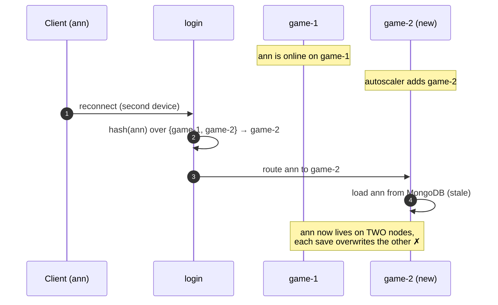
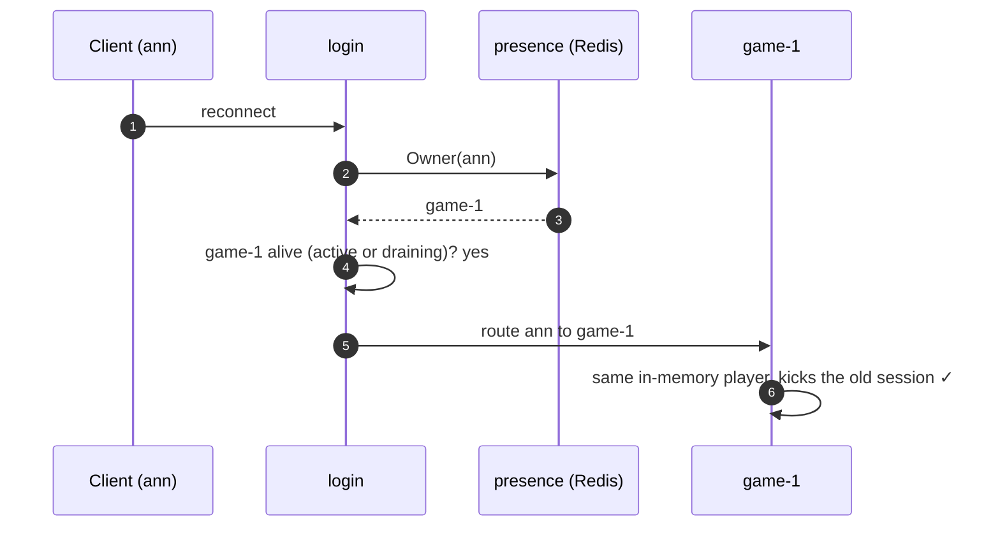
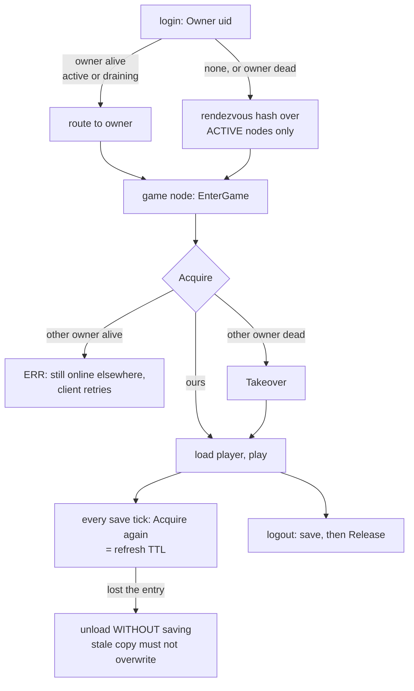

# presence — who owns each online player

[中文](README.zh-CN.md)

`game/presence` records **which game node currently holds each online player
in memory**. It is what keeps a player from being loaded on two nodes at once
while game nodes are added, drained, upgraded or crash.

## Why rendezvous hashing alone is not enough

Login picks a game node with rendezvous hashing over the registered nodes.
That is sticky only while the set of nodes does not change:



With the directory, login asks "who owns ann?" first:



## Data

```
key:   gs:presence:<uid>      value: <game node id>      ttl: 5 min, refreshed every save tick
```

| Operation | Who | Rule |
|---|---|---|
| `Owner(uid)` | login | the node holding the player, or `""` |
| `Acquire(uid, node)` | game node, before loading a player | succeeds if free or already ours; otherwise returns the other owner |
| `Takeover(uid, from, node)` | game node | only if the current owner is still `from` (a dead node) |
| `Release(uid, node)` | game node, after the final save | deletes only if still ours |

Every Redis operation is a Lua compare-and-set, so two nodes racing for one
player cannot both win (`TestConcurrentAcquireHasOneWinner`).

## The rules, end to end



* **Alive** means listed in the registry under `game` or `game-draining`
  (`cluster.NodeAlive`). A negative answer is re-read from Redis before
  anyone acts on it, because caches refresh each key separately.
* **Fail closed**: if Redis cannot be read, login returns `SERVICE_UNAVAILABLE`
  instead of guessing — guessing could create a second copy.
* **Release before leaving the online map**: a request arriving during
  logout reaches the closing entity and is re-dispatched to a fresh one,
  which acquires ownership again.

## Implementations

| Type | Used when |
|---|---|
| `presence.Memory` | all-in-one mode and unit tests (one process) |
| `presence.Redis` | distributed mode (`cluster.registry: redis`), shared by every login and game node |

`bootstrap` picks one automatically.

## Tests

* `presence_test.go` — ownership rules and a concurrent race, against memory and Redis (miniredis).
* `test/cluster/drain_test.go` — scale out, drain, shutdown and crash takeover with real NATS.
