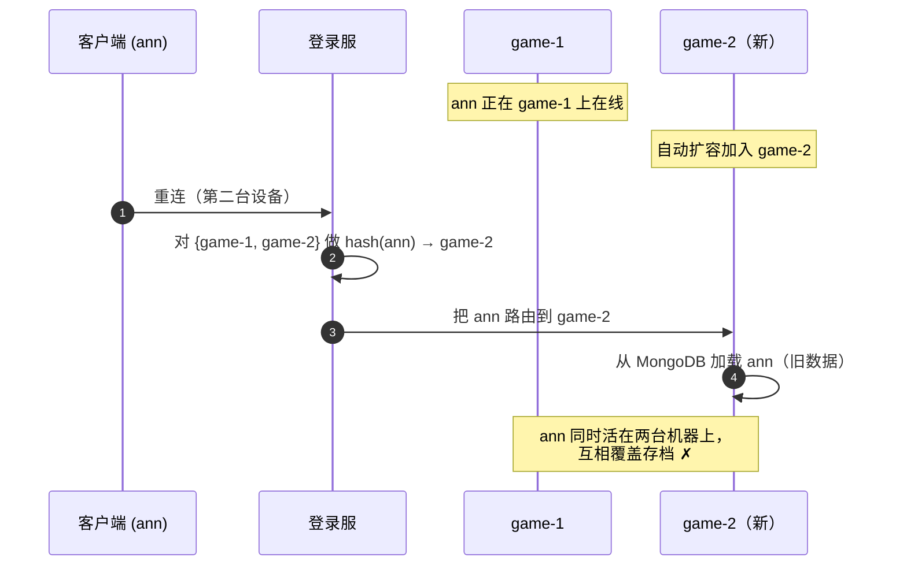
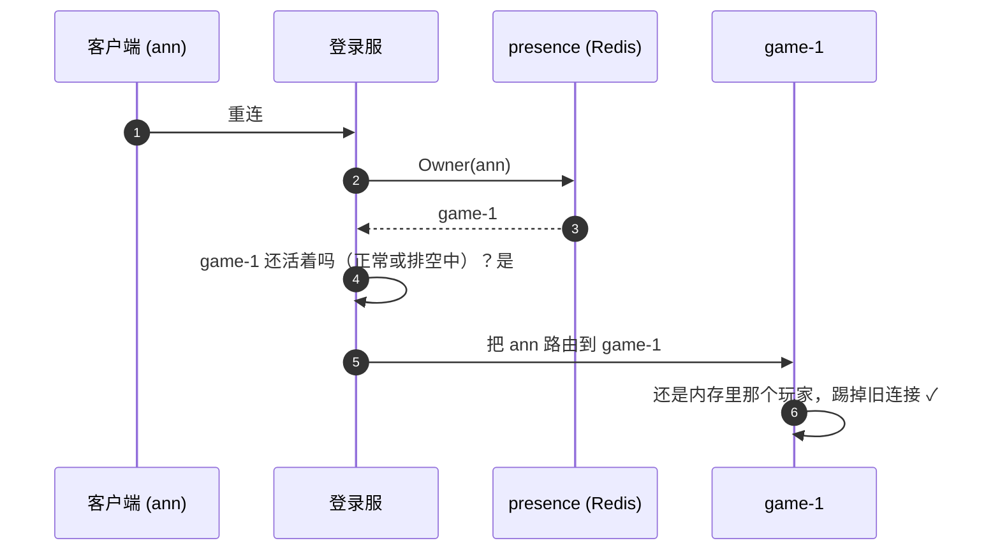
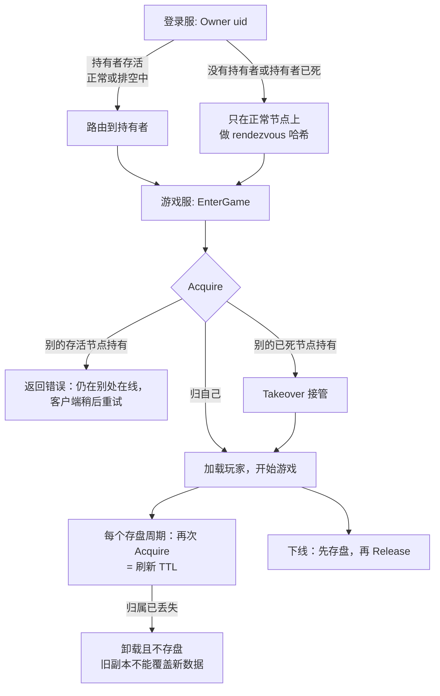

# presence —— 每个在线玩家归谁管

[English](README.md)

`game/presence` 记录**每个在线玩家当前由哪台游戏服保存在内存里**。
有了它，在游戏服扩容、排空、升级或宕机时，同一个玩家都不会同时被加载到两台机器上。

## 为什么只靠一致性哈希不够

登录服用 rendezvous 哈希在已注册的游戏服中选一台。只有节点集合不变时，这种选择才是"粘性"的：



有了归属目录，登录服会先问一句"ann 归谁？"：



## 数据

```
key:   gs:presence:<uid>      value: <游戏服节点 id>      ttl: 5 分钟，每次存盘周期刷新
```

| 操作 | 调用方 | 规则 |
|---|---|---|
| `Owner(uid)` | 登录服 | 返回持有该玩家的节点，没有则为 `""` |
| `Acquire(uid, node)` | 游戏服，加载玩家之前 | 空闲或本来就是自己时成功；否则返回另一个持有者 |
| `Takeover(uid, from, node)` | 游戏服 | 仅当当前持有者仍是 `from`（一个已死节点）时成功 |
| `Release(uid, node)` | 游戏服，最后一次存盘之后 | 仅当仍归自己时删除 |

每个 Redis 操作都是 Lua 实现的"比较并设置"，两台机器同时抢一个玩家不可能都成功
（见 `TestConcurrentAcquireHasOneWinner`）。

## 完整规则



* **存活**指在注册中心的 `game` 或 `game-draining` 下能找到该节点（`cluster.NodeAlive`）。
  判定"已死"之前会重新从 Redis 读一次，因为各进程的缓存是按 key 分别刷新的。
* **失败即拒绝**：读不到 Redis 时登录服返回 `SERVICE_UNAVAILABLE`，而不是瞎猜——猜错就可能出现第二份副本。
* **先 Release 再离开在线表**：下线过程中到达的请求会落到正在关闭的实体上，
  再被转给一个新实体，新实体会重新获取归属。

## 实现

| 类型 | 使用场景 |
|---|---|
| `presence.Memory` | 单体模式和单元测试（单进程） |
| `presence.Redis` | 分布式模式（`cluster.registry: redis`），所有登录服和游戏服共享 |

`bootstrap` 会自动选择。

## 测试

* `presence_test.go` —— 归属规则和并发抢占，分别针对内存和 Redis（miniredis）实现。
* `test/cluster/drain_test.go` —— 用真实 NATS 测试扩容、排空、停服和宕机接管。
