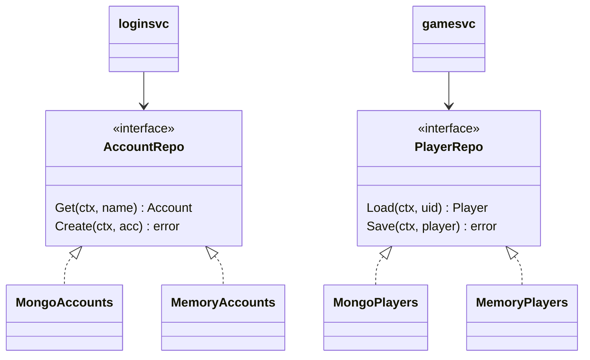
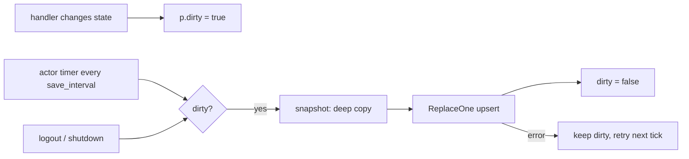

# repo & model — persistence

[中文](README.zh-CN.md)

`game/repo` is the persistence boundary. Services depend only on interfaces;
implementations are chosen in `bootstrap` from `storage.driver`.



| Error | Meaning |
|---|---|
| `repo.ErrNotFound` | document does not exist (new account / new character) |
| `repo.ErrDuplicate` | unique key taken (concurrent registration) |

## Documents (`game/model`)

**accounts** collection

| Field (bson) | Type | Note |
|---|---|---|
| `_id` | string | account name (unique ⇒ race-free registration) |
| `pwd` | binary | bcrypt hash |
| `uid` | int64 | Snowflake id |
| `created_at` | date | |

**players** collection — one document per character

| Field (bson) | Type |
|---|---|
| `_id` | int64 uid |
| `name`, `level`, `exp`, `gold` | |
| `items` | array of `{id, n}` |
| `pos_x`, `pos_y` | float |
| `created_at`, `last_login_at` | date |
| `version` | int64, +1 per save |

```json
{ "_id": 1234567890, "name": "alice", "level": 2, "exp": 0, "gold": 1100,
  "items": [{"id": 1001, "n": 3}, {"id": 1002, "n": 2}, {"id": 2001, "n": 1}],
  "pos_x": 520, "pos_y": 510, "version": 4 }
```

## Save strategy



* whole-document upsert: simple, idempotent, no partial-update bugs;
* the snapshot is a deep copy, so storage never aliases live state;
* on failure the player stays dirty and is retried.

Tags are the schema: renaming a bson tag is a data migration. Adding fields is free.

## Implementations

| | Mongo | Memory |
|---|---|---|
| use | production | development, tests, `allinone.yaml` |
| durability | yes | lost on exit |
| sharing across processes | yes | no (Validate refuses it in NATS mode) |
| isolation | — | stores deep copies to behave like a real DB |

Tests share one memory store between several nodes with `bootstrap.WithRepos`.
