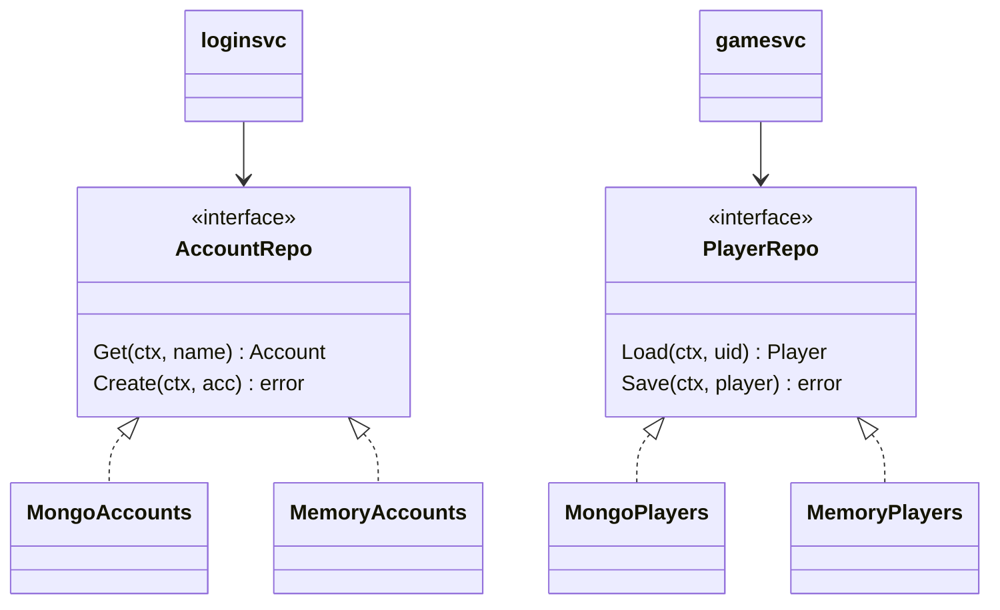
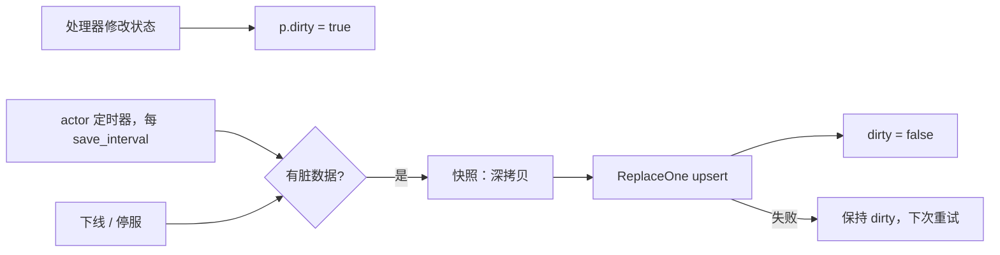

# repo 与 model —— 持久化

[English](README.md)

`game/repo` 是持久化边界。服务只依赖接口；具体实现由 `bootstrap` 根据 `storage.driver` 选择。



| 错误 | 含义 |
|---|---|
| `repo.ErrNotFound` | 文档不存在（新账号 / 新角色） |
| `repo.ErrDuplicate` | 唯一键已被占用（并发注册） |

## 文档结构（`game/model`）

**accounts** 集合

| 字段（bson） | 类型 | 说明 |
|---|---|---|
| `_id` | string | 账号名（唯一 ⇒ 注册无竞态） |
| `pwd` | binary | bcrypt 哈希 |
| `uid` | int64 | 雪花 ID |
| `created_at` | date | |

**players** 集合 —— 每个角色一个文档

| 字段（bson） | 类型 |
|---|---|
| `_id` | int64 uid |
| `name`、`level`、`exp`、`gold` | |
| `items` | `{id, n}` 数组 |
| `pos_x`、`pos_y` | float |
| `created_at`、`last_login_at` | date |
| `version` | int64，每次保存 +1 |

```json
{ "_id": 1234567890, "name": "alice", "level": 2, "exp": 0, "gold": 1100,
  "items": [{"id": 1001, "n": 3}, {"id": 1002, "n": 2}, {"id": 2001, "n": 1}],
  "pos_x": 520, "pos_y": 510, "version": 4 }
```

## 存盘策略



* 整文档 upsert：简单、幂等，不会有部分更新的 bug；
* 快照是深拷贝，存储层永远不会引用到活动状态；
* 失败时玩家保持脏标记，下次重试。

bson 标签就是表结构：改名等于数据迁移；新增字段则无成本。

## 实现对比

| | Mongo | 内存 |
|---|---|---|
| 用途 | 生产 | 开发、测试、`allinone.yaml` |
| 持久性 | 有 | 进程退出即丢失 |
| 跨进程共享 | 支持 | 不支持（NATS 模式下 Validate 会拒绝） |
| 隔离 | — | 存储深拷贝，行为与真实数据库一致 |

测试中通过 `bootstrap.WithRepos` 让多个节点共享同一个内存存储。
