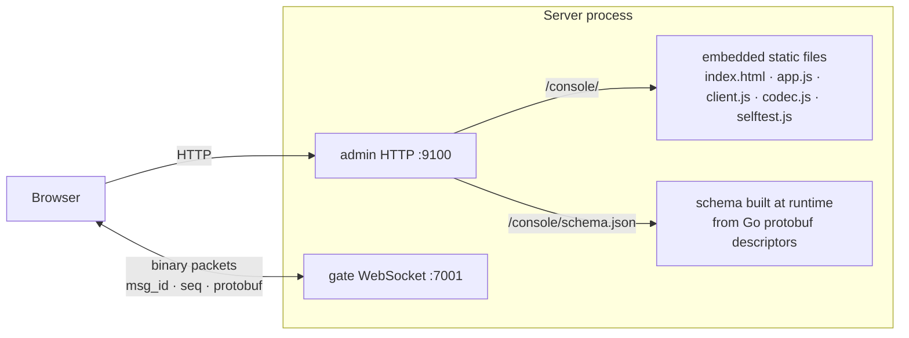

# webconsole — browser test console

[中文](README.zh-CN.md)

A test client that runs in the browser. Start the server with one command,
open a URL, and play the game protocol by clicking — or run the whole client
flow with **one button** and get a pass/fail checklist.

```bash
go run ./cmd/server -config configs/allinone.yaml
# open http://127.0.0.1:9100/        (redirects to /console/)
```

## What you can do

| Panel | Function |
|---|---|
| Connection | WebSocket URL (prefilled from the server config), connect / disconnect |
| Login & enter game | account, password, character name; new accounts are registered automatically |
| One-click self-test | 13 checks on a separate connection with a fresh account (see below) |
| Character | name, level, EXP bar, gold, position — updated live by pushes |
| Scene map | 1000×1000 world, your 3×3 AOI view highlighted, nearby players; move by clicking or WASD / arrow keys |
| Bag | items with names from the item table, **Use** buttons |
| Chat | world / nearby channels, live incoming messages |
| GM command | `help`, `additem 1003 2`, `addgold 500`, `addexp 300`, `info` |
| Message log | every request (→), response (←), push (⇠) decoded as JSON; click a line to expand; passwords masked |
| Header | connection state, uid, round-trip time, 中文 / English switch |

Open the page in two browser windows (or one normal + one private window) to
see two players meet on the map, chat, and see each other move. Logging in to
the same account in a second window shows the duplicate-login kick.

## One-click self-test

| # | Check | Expected |
|---|---|---|
| 1 | connect to gate | WebSocket open |
| 2 | heartbeat | `HeartbeatResp`, RTT measured |
| 3 | request before login | `NOT_AUTHENTICATED` |
| 4 | login with a new random account | uid, `new_account = true` |
| 5 | enter game | Lv.1 character at the spawn point |
| 6 | get bag | starter pack: 3 stacks |
| 7 | use Gold Pouch | `ItemUseResp` + `PlayerInfoPush` (gold +100) + `BagUpdatePush` |
| 8 | use Iron Sword | `ERR_ITEM_NOT_USABLE` |
| 9 | world chat | own `ChatPush` received |
| 10 | move | `SceneMoveResp` with the new position |
| 11 | teleport | `ERR_MOVE_TOO_FAR` |
| 12 | GM `info` | output (or *skipped* when GM is disabled) |
| 13 | disconnect | closed cleanly |

The result is also exposed as `window.__selftest` and `body[data-selftest]`
for automation.

## How it works



* **No generated JavaScript, no CDN.** `schema.json` lists every message
  (field names, numbers, kinds), every enum and the `msg_id` table, built from
  the same descriptors the server uses. `codec.js` (~300 lines) encodes and
  decodes proto3 binary from it. Adding a message to `proto/` and
  `game/protocol` makes it available in the console automatically.
* 64-bit integers (uids) are handled as strings, so Snowflake ids keep full precision.
* `client.js` mirrors `framework/client`: seq correlation, pushes, `ErrorResp`
  → `ServerError`, heartbeat.

| File | Role |
|---|---|
| `webconsole.go` | `BuildSchema`, `Handler` (static files + schema) |
| `static/codec.js` | proto3 codec driven by the schema |
| `static/client.js` | `GameClient`: one WebSocket connection |
| `static/selftest.js` | the 13-step self-test |
| `static/app.js` | UI controller, i18n, map rendering |
| `static/index.html`, `style.css` | layout (light/dark, responsive down to phone width) |

## Configuration

```yaml
admin:
  addr: ${ADMIN_ADDR:-127.0.0.1:9100}
console:
  enabled: ${CONSOLE_ENABLED:-true}   # true only in configs/allinone.yaml
```

The page suggests `ws://<page host>:<gate ws port><ws path>`, taken from the
`gate` section; edit the URL field to target another gate.

> **Security:** the console is a development / QA tool served on the admin
> port. It is disabled in `gate.yaml`, `login.yaml` and `game.yaml`; never
> expose the admin port publicly.

## Tests

* `webconsole_test.go` — the schema covers every registered message, every
  referenced type and the error-code enums; the handler serves the page with
  JavaScript MIME types and the schema.
* `test/webconsole/` — **headless Chrome** (Puppeteer) drives the real page
  against a real server: self-test, manual flow, two players interacting,
  duplicate-login kick, error toast, language switch, mobile layout, no
  JavaScript errors (28 checks). See [test/README](../../test/README.md).
