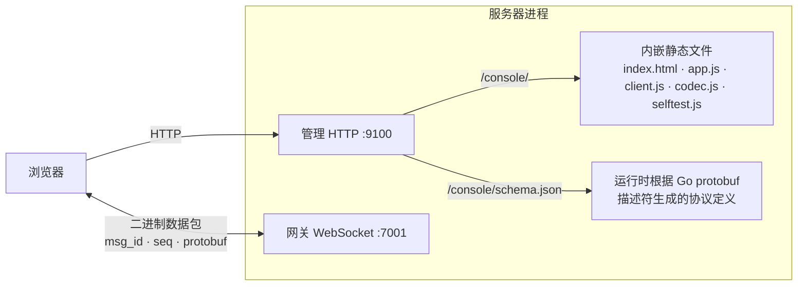

# webconsole —— 网页测试控制台

[English](README.md)

一个在浏览器里运行的测试客户端。用一条命令启动服务器，打开一个网址，就能点按钮体验整套游戏协议；
也可以**一键**跑完整个客户端流程，得到逐项"通过/失败"清单。

```bash
go run ./cmd/server -config configs/allinone.yaml
# 浏览器打开 http://127.0.0.1:9100/      （自动跳转到 /console/）
```

## 能做什么

| 面板 | 功能 |
|---|---|
| 连接 | WebSocket 地址（根据服务器配置自动填好）、连接 / 断开 |
| 登录与进入游戏 | 账号、密码、角色名；新账号自动注册 |
| 一键自检 | 用独立连接和全新账号做 13 项检查（见下文） |
| 角色 | 名字、等级、经验条、金币、坐标 —— 由推送实时更新 |
| 场景地图 | 1000×1000 世界，高亮显示你的 3×3 AOI 视野和附近玩家；点击地图或 WASD / 方向键移动 |
| 背包 | 道具名来自配置表，带**使用**按钮 |
| 聊天 | 世界 / 附近频道，实时接收消息 |
| GM 命令 | `help`、`additem 1003 2`、`addgold 500`、`addexp 300`、`info` |
| 消息日志 | 每个请求（→）、响应（←）、推送（⇠）都解码成 JSON 显示；点击可展开；密码会被打码 |
| 顶栏 | 连接状态、uid、往返延迟、中文 / English 切换 |

在两个浏览器窗口（或一个普通窗口 + 一个无痕窗口）中打开页面，就能看到两个玩家在地图上相遇、
互相聊天、看到对方移动。在第二个窗口登录同一个账号，可以看到顶号踢人的效果。

## 一键自检

| # | 检查 | 期望结果 |
|---|---|---|
| 1 | 连接网关 | WebSocket 打开 |
| 2 | 心跳 | 收到 `HeartbeatResp`，测出 RTT |
| 3 | 未登录就发请求 | `NOT_AUTHENTICATED` |
| 4 | 用随机新账号登录 | 拿到 uid，`new_account = true` |
| 5 | 进入游戏 | 出生点上的 1 级角色 |
| 6 | 查看背包 | 新手礼包：3 种道具 |
| 7 | 使用金币袋 | `ItemUseResp` + `PlayerInfoPush`（金币 +100）+ `BagUpdatePush` |
| 8 | 使用铁剑 | `ERR_ITEM_NOT_USABLE` |
| 9 | 世界聊天 | 收到自己的 `ChatPush` |
| 10 | 移动 | `SceneMoveResp` 返回新坐标 |
| 11 | 瞬移 | `ERR_MOVE_TOO_FAR` |
| 12 | GM `info` | 返回输出（GM 关闭时标记为*跳过*） |
| 13 | 断开 | 正常关闭 |

结果同时通过 `window.__selftest` 和 `body[data-selftest]` 暴露出来，方便自动化测试读取。

## 工作原理



* **不需要生成 JavaScript 代码，也不依赖 CDN。** `schema.json` 列出了所有消息（字段名、编号、类型）、
  所有枚举和 `msg_id` 映射表，来源就是服务器自己使用的描述符。`codec.js`（约 300 行）据此完成
  proto3 二进制编解码。在 `proto/` 和 `game/protocol` 中新增消息后，控制台会自动支持。
* 64 位整数（uid）以字符串处理，雪花 ID 不会丢失精度。
* `client.js` 与 `framework/client` 行为一致：按 seq 匹配、推送、`ErrorResp` → `ServerError`、心跳。

| 文件 | 作用 |
|---|---|
| `webconsole.go` | `BuildSchema`、`Handler`（静态文件 + schema） |
| `static/codec.js` | 基于 schema 的 proto3 编解码 |
| `static/client.js` | `GameClient`：一条 WebSocket 连接 |
| `static/selftest.js` | 13 步自检 |
| `static/app.js` | 界面控制、中英切换、地图绘制 |
| `static/index.html`、`style.css` | 布局（浅色/深色，适配到手机宽度） |

## 配置

```yaml
admin:
  addr: ${ADMIN_ADDR:-127.0.0.1:9100}
console:
  enabled: ${CONSOLE_ENABLED:-true}   # 只有 configs/allinone.yaml 中为 true
```

页面会根据 `gate` 配置给出默认地址 `ws://<页面主机>:<网关 ws 端口><ws 路径>`；要连其他网关，修改地址栏即可。

> **安全：** 控制台是开发 / 测试工具，挂在管理端口上。`gate.yaml`、`login.yaml`、`game.yaml` 中都没有开启；
> 管理端口绝不能暴露到公网。

## 测试

* `webconsole_test.go` —— schema 覆盖所有已注册消息、所有被引用的类型和错误码枚举；
  处理器以 JavaScript MIME 类型提供页面和 schema。
* `test/webconsole/` —— 用**无头 Chrome**（Puppeteer）在真实服务器上操作真实页面：自检、手动流程、
  两个玩家互动、顶号踢人、错误提示、语言切换、手机布局、无 JavaScript 错误（共 28 项检查）。
  见 [test/README](../../test/README.zh-CN.md)。
