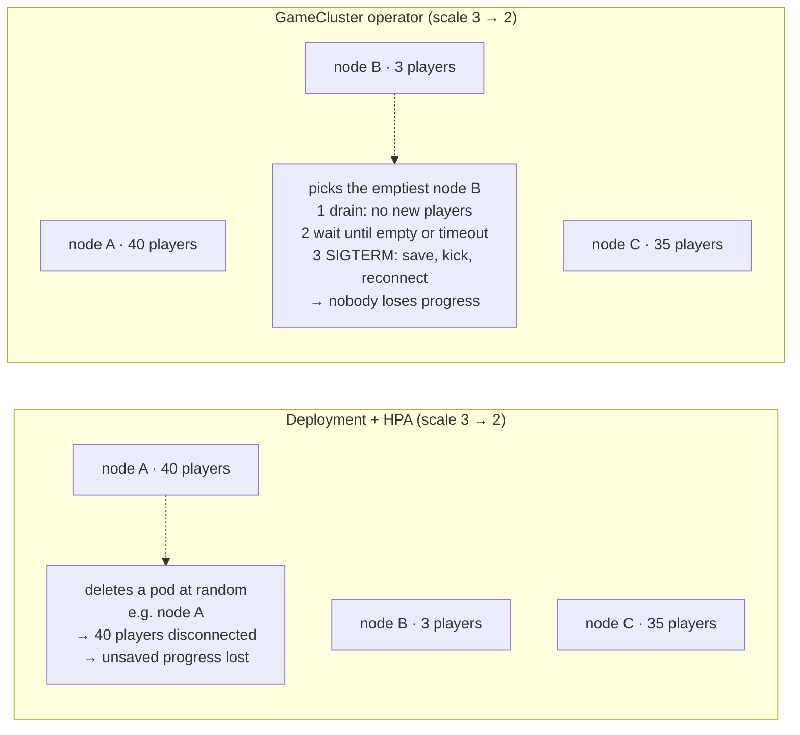
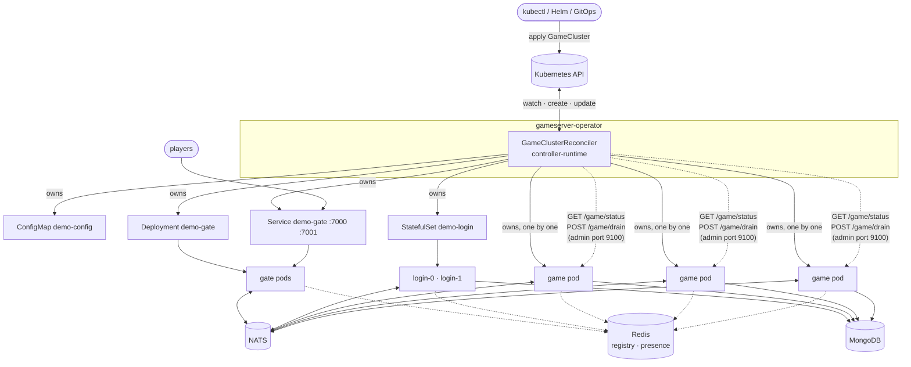
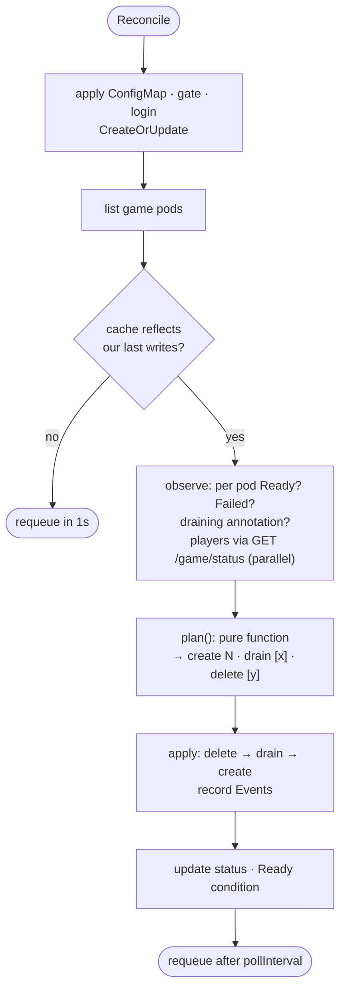
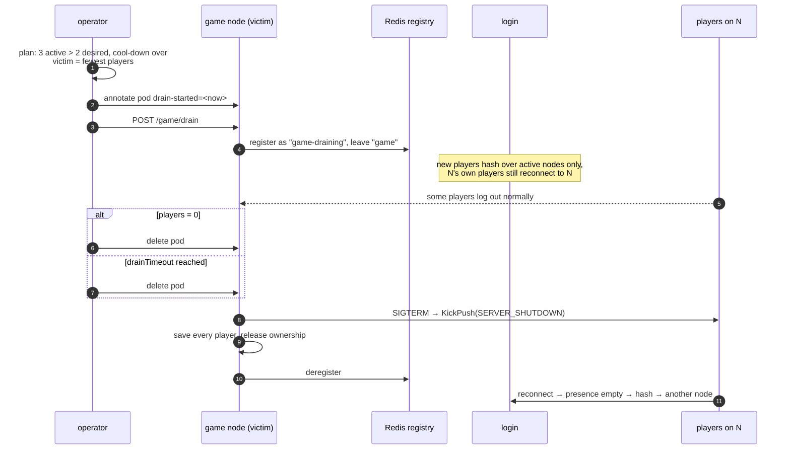
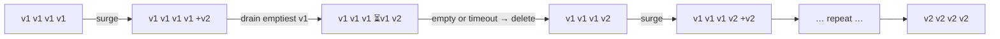
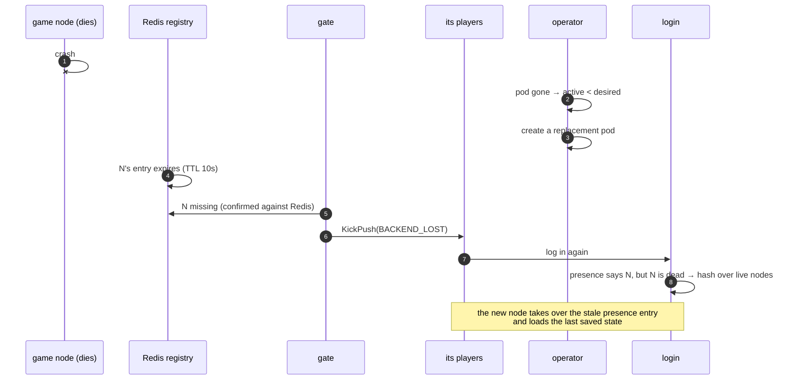

# GameCluster Operator

[中文](README.zh-CN.md) · [Helm chart](../deploy/helm/gameserver/README.md) · [E2E test](../test/k8s/README.md) · [Project README](../README.md)


A Kubernetes operator, written in Go, that runs the game server of this
repository as **one custom resource** and handles the parts plain Kubernetes
cannot: game servers are **stateful**. Players live in a node's memory, so
nodes must never be killed at random.

```yaml
apiVersion: gameserver.dev/v1alpha1
kind: GameCluster
metadata:
  name: demo
spec:
  image: gameserver:dev
  infra: { natsURL: "nats://gs-nats:4222", redisAddr: "gs-redis:6379", mongoURI: "mongodb://gs-mongo:27017" }
  gate:  { replicas: 2 }
  login: { replicas: 2 }
  game:
    autoscale: { minReplicas: 2, maxReplicas: 6, targetPlayersPerNode: 50 }
    drainTimeout: 2m
```

```console
$ kubectl get gamecluster -n game
NAME   PHASE     PLAYERS   GAME   DESIRED   DRAINING   GATE   LOGIN   AGE
demo   Running   160       4      4         0          2      2       3m6s
```

## Contents

1. [Why an operator?](#1-why-an-operator)
2. [What it does](#2-what-it-does)
3. [Architecture](#3-architecture)
4. [The reconcile loop](#4-the-reconcile-loop)
5. [Scaling out](#5-scaling-out)
6. [Draining and scaling in](#6-draining-and-scaling-in)
7. [Rolling update with players online](#7-rolling-update-with-players-online)
8. [When a node crashes](#8-when-a-node-crashes)
9. [Never two copies of a player](#9-never-two-copies-of-a-player)
10. [API reference](#10-api-reference)
11. [Run it locally (kind)](#11-run-it-locally-kind)
12. [Testing](#12-testing)
13. [Design decisions](#13-design-decisions)
14. [Production notes](#14-production-notes)
15. [Code map](#15-code-map)

---

## 1. Why an operator?

A `Deployment` treats pods as interchangeable. For a game node that is wrong:



| Need | Deployment / HPA | This operator |
|---|---|---|
| Choose **which** node to remove | random / newest | fewest players, outdated first |
| Let players leave before removal | no | drain, then wait (`drainTimeout`) |
| Scale on **online players** | needs a custom metrics pipeline | built in (`targetPlayersPerNode`) |
| Rolling update without dropping players | pods die mid-session | surge one, drain one, repeat |
| Unique id per login node (Snowflake) | not possible | StatefulSet pod index |
| One object for the whole stack | 5+ manifests | one `GameCluster` |

## 2. What it does

| Feature | How |
|---|---|
| **Provision** | ConfigMap (server configs), gate Deployment + Service, login StatefulSet + headless Service, game pods |
| **Autoscale** | `desired = ceil(players / targetPlayersPerNode)`, clamped to `[min, max]`; scale-up is immediate, scale-down waits for `scaleDownDelay` |
| **Graceful drain** | annotate the pod → `POST /game/drain` → wait until 0 players or `drainTimeout` → delete (SIGTERM saves and kicks the rest) |
| **Rolling update** | any change to the game pod template (image, config, resources) → add one new node, drain one old node, repeat |
| **Self-healing** | failed or vanished game pods are replaced; gates kick players of lost nodes so they reconnect |
| **Observability** | `kubectl get gc` columns, per-node status, Kubernetes Events for every decision, a `Ready` condition |
| **Safe by default** | non-root, read-only root FS, no capabilities, seccomp `RuntimeDefault`; probes on every pod |

## 3. Architecture



* Gate and login are stateless → standard controllers (`Deployment`, `StatefulSet`).
* Game nodes are stateful → **bare pods managed by the operator**, each with a
  unique name that doubles as the node id inside the game cluster.
* Every child has an owner reference to the `GameCluster`: deleting it deletes everything.

## 4. The reconcile loop

Every pass is short and idempotent. It runs on every change to the
`GameCluster` or any object it owns, and at least every `pollInterval` (5s)
to refresh player counts.



The decision logic is a **pure function** (`planner.go`) with no Kubernetes
calls, so every rule is unit tested with plain tables. Its rules, in order:

| # | Rule | Why |
|---|---|---|
| 1 | Failed pods are deleted (and replaced by rule 3) | a crashed pod never serves again |
| 2 | A draining pod is deleted when it has **0 players** or its drain **timed out** | deletion = SIGTERM: the node saves and kicks the rest, clients reconnect elsewhere |
| 3 | Fewer active nodes than desired → **create** the difference at once | capacity first |
| 4 | Any active node still starting → **wait** | never remove capacity while new nodes boot |
| 5 | More active nodes than desired → **drain one**: outdated first, then fewest players; a pure scale-down waits `scaleDownDelay` | minimal disruption, no flapping |
| 6 | Outdated nodes and nothing draining → **create one surge node** | rolling update keeps full capacity |

At most **one node drains at a time** (a node deleted in this pass counts), so
capacity never drops by more than one node.

**Expectations.** Controller-runtime reads from an informer cache that lags
behind writes by a few milliseconds. Without care, the pass right after
"create a pod" may not see that pod and create another one. The reconciler
remembers its own writes (`created`, `draining`, `deleted`) and skips planning
until the cache shows them (bounded by 30s).

## 5. Scaling out

```mermaid
sequenceDiagram
    autonumber
    participant P as players
    participant G as game nodes
    participant O as operator
    participant K as Kubernetes
    P->>G: 160 players log in
    loop every 5s
      O->>G: GET /game/status
      G-->>O: players per node
    end
    O->>O: desired = ceil(160 / 50) = 4, active = 2
    O->>K: create 2 game pods
    K-->>G: pods Ready, register as "game"
    Note over G: new logins hash over 4 nodes,<br/>online players stay where they are
```



Real events from the end-to-end test:

```text
Created game node demo-game-b2c6b: scale up: 0 active, 2 desired (0 players)
Created game node demo-game-9zw97: scale up: 2 active, 3 desired (101 players)
Created game node demo-game-dxrhk: scale up: 3 active, 4 desired (155 players)
```

## 6. Draining and scaling in



The annotation is the operator's durable record of the decision: if the
operator restarts, or the game container restarts and forgets it was
draining, the next pass sees the annotation and re-sends `POST /game/drain`.

## 7. Rolling update with players online

Change anything in the game pod template (`image`, config, `resources`) and
the operator replaces every game node, one at a time, without dropping below
the desired capacity:



From the test (4 nodes, 160 robots online, `drainTimeout: 20s`):

```text
Created  demo-game-nnnpz: rolling update: 4 outdated node(s), add one new node first
Draining demo-game-dxrhk: rolling update: drain outdated node demo-game-dxrhk (0 players)
Removed  demo-game-dxrhk
...
Draining demo-game-vf6r8: rolling update: drain outdated node demo-game-vf6r8 (56 players)
Removed  demo-game-vf6r8                     ← 24 s later; its 56 players reconnected to v2 nodes
```

Across test runs all four nodes were replaced in **52–74 seconds** and every robot was back in game.

All roles share one image, so the gate Deployment (`maxUnavailable: 0`,
`maxSurge: 1`) and the login StatefulSet roll at the same time with their
standard strategies; clients of a replaced gate get `KickPush(SERVER_SHUTDOWN)`
and reconnect through the other gate.

## 8. When a node crashes

A pod killed without a graceful stop (OOM, node failure, `kubectl delete --force`)
cannot tell anyone. Three mechanisms cover it:



Detection takes about `registry_ttl` + `backend_check_interval` (≈ 12 s).
A player who logs in again inside that window can still be routed to the dead
node and is kicked once more, then lands on a live node.

Progress since the last periodic save (`save_interval`, 30s) is lost on a
crash — the same as any in-memory game server; graceful paths (drain, rolling
update, scale-in) lose nothing.

## 9. Never two copies of a player

Moving players between nodes is only safe if a player can never be loaded on
two nodes at the same time. The game server keeps a **presence directory**
in Redis (`gs:presence:<uid> → node`), see [game/presence](../game/presence/README.md):

* login routes an online player to the node that **owns** it (active or draining), and
  only hashes players that are not online;
* a node must **acquire** the entry (Lua compare-and-set) before loading a player and
  **release** it after the final save;
* "this node is dead" is always **confirmed against Redis** before acting on it,
  because each process caches registry keys separately.

## 10. API reference

`gameserver.dev/v1alpha1`, kind `GameCluster`, short name `gc`.

| Field | Default | Description |
|---|---|---|
| `spec.image` | — (required) | game server image, all roles |
| `spec.imagePullPolicy` | `IfNotPresent` | |
| `spec.logLevel` | `info` | `debug` · `info` · `warn` · `error` |
| `spec.infra.natsURL` | — (required) | message bus |
| `spec.infra.redisAddr` | — (required) | registry and presence |
| `spec.infra.mongoURI` / `mongoDatabase` | — / `game` | player database |
| `spec.gate.replicas` | `2` | gate Deployment size |
| `spec.gate.serviceType` | `ClusterIP` | `NodePort` · `LoadBalancer` |
| `spec.gate.console` | `false` | serve the browser test console on gate port 9100 |
| `spec.login.replicas` | `1` | login StatefulSet size (≤ 1024: Snowflake worker ids) |
| `spec.game.replicas` | `2` | fixed size when `autoscale` is not set |
| `spec.game.autoscale.minReplicas` / `maxReplicas` | — | bounds (validated: min ≤ max) |
| `spec.game.autoscale.targetPlayersPerNode` | — | planned load per node |
| `spec.game.autoscale.scaleDownDelay` | `2m` | cool-down before a scale-down |
| `spec.game.drainTimeout` | `5m` | max wait for players to leave a draining node |
| `spec.game.gmEnabled` | `false` | debug GM commands |
| `spec.*.resources` | — | container requests/limits per role |

| Status | Meaning |
|---|---|
| `phase` | `Pending` · `Running` · `Scaling` · `Updating` |
| `players` | online players (sum over game nodes) |
| `gate` / `login` | `{desired, ready}` |
| `game` | `{desired, ready, draining, outdated}` |
| `nodes[]` | `{name, phase: Starting/Active/Draining, players, version, drainStartedAt}` |
| `lastScaleTime` | last capacity change (for the cool-down) |
| `conditions[Ready]` | `True` when gate, login and game are at the desired size |

```console
$ kubectl get gc demo -n game -o jsonpath='{range .status.nodes[*]}{.name}{"\t"}{.phase}{"\t"}{.players}{"\n"}{end}'
demo-game-llkjf   Active   0
demo-game-wlzms   Active   55
demo-game-x7fpf   Active   65
```

`llkjf` was just added for 120 players: online players stay where they are
(moving them would cost a reconnect), so a new node fills up with new logins.

## 11. Run it locally (kind)

```bash
# 1. tools: Docker, kind, kubectl, Helm
kind create cluster --name gs

# 2. images
docker build -t gameserver:dev -f deploy/Dockerfile .
docker build -t gameserver-operator:dev operator/
kind load docker-image gameserver:dev gameserver-operator:dev --name gs

# 3. operator + dev infrastructure + a sample GameCluster
helm install gs deploy/helm/gameserver -n game --create-namespace
kubectl get gc -n game -w

# 4. play: port-forward the gate and open the browser console
kubectl port-forward -n game svc/demo-gate 7000:7000 7001:7001 &
kubectl port-forward -n game deploy/demo-gate 9100:9100 &
#    http://127.0.0.1:9100/  → "Run self-test"

# 5. load: 200 robots → watch the operator add nodes
go run ./cmd/robot -addr 127.0.0.1:7000 -n 200 -duration 5m -reconnect
kubectl get events -n game --field-selector involvedObject.kind=GameCluster -w
```

## 12. Testing

| Level | What | Where |
|---|---|---|
| Planner unit tests | 19 table cases (scale up/down, cool-down, drain timeout, failed pods, unknown counts, rolling update) + a simulation that runs a whole rolling update and asserts capacity never drops | `internal/controller/planner_test.go` |
| Reconciler tests | full reconcile passes against controller-runtime's fake API server and a fake game-node API: provisioning, autoscale → drain → delete, drain re-sent after a container restart, drain timeout, rolling update | `internal/controller/gamecluster_controller_test.go` |
| Game server integration | scale out → drain → shutdown with real NATS and Redis protocol; crashed node takeover; stale-cache regression | `test/cluster/drain_test.go`, `framework/cluster/registry_redis_test.go` |
| **End to end on Kubernetes** | real kind cluster, 160 robots online the whole time: autoscale 2 → 4, force-kill the busiest node, rolling update of every node, scale back to 2, verify MongoDB | [`test/k8s/e2e.sh`](../test/k8s/README.md) |

```bash
cd operator && go test ./...      # unit + reconciler tests
bash test/k8s/e2e.sh              # needs the chart installed on a cluster
```

Last end-to-end run (kind, Kubernetes 1.37), 160 robots online for 6 minutes:

| Check | Result |
|---|---|
| autoscale 2 → 4 game nodes | 4 s after 160 players were online |
| force-kill the busiest node (88 players) | replaced in 10 s, all 160 players back online |
| rolling update of 4 nodes with players online | 74 s |
| robots: login failures / stranded | **0 / 0** (445 kicks, 401 reconnects, 59 566 requests, 2.1 ms avg) |
| scale in to 2 after robots leave | 28 s |
| characters in MongoDB | 160 / 160 |

## 13. Design decisions

| Decision | Alternatives | Why |
|---|---|---|
| Game nodes are **bare pods** owned by the operator | StatefulSet, Deployment | only the operator knows player counts, so only it can choose which node to remove; StatefulSets always remove the highest ordinal |
| Player counts via **HTTP `/game/status`** | Prometheus + custom metrics adapter | no extra components; the same endpoint answers "drain" |
| Drain decision stored as a **pod annotation** | in-memory state | survives operator restarts and leader changes |
| **One drain at a time** | parallel drains | capacity never drops by more than one node; simple to reason about |
| Pure **planner** function | logic inside Reconcile | every rule is a table test; no API server needed |
| **Expectations** for own writes | trust the cache | avoids double creates/drains caused by cache lag |
| Login as **StatefulSet** | Deployment + id allocation service | the pod index (`apps.kubernetes.io/pod-index`) is a free, stable, unique Snowflake worker id |
| Status written with **Update** | merge patch | zero values (`players: 0`) must be written too; conflicts are retried |
| CRD **validation** in the schema (enums, minimums, CEL `min ≤ max`) | webhook | no TLS/webhook server to operate |

## 14. Production notes

* Run 2 operator replicas with leader election (the chart default enables it).
* Use managed NATS / Redis / MongoDB, not the chart's single-pod dev infra.
* Protect the admin port (9100) with a `NetworkPolicy`: `/game/drain` is not authenticated.
* Set `resources` for every role, and spread game pods across zones (topology spread constraints are a natural next step).
* Next steps for this project: a `PodDisruptionBudget`-aware eviction path, Prometheus metrics for the operator's decisions, and alerting on `Ready=False`.

## 15. Code map

```
operator/
├── api/v1alpha1/
│   ├── gamecluster_types.go       spec, status, kubebuilder markers (validation, printer columns)
│   └── zz_generated.deepcopy.go   generated by controller-gen
├── internal/controller/
│   ├── gamecluster_controller.go  Reconcile: provision, observe, apply plan, status, expectations
│   ├── planner.go                 pure scaling / drain / rolling-update rules
│   ├── resources.go               ConfigMap, Deployment, StatefulSet, Service, Pod builders
│   └── nodeclient.go              HTTP client for /game/status and /game/drain
├── cmd/main.go                    manager, leader election, health probes, metrics
├── config/crd · config/rbac       generated CRD and ClusterRole
└── Dockerfile                     static binary on distroless, non-root
```

Regenerate after changing the API:

```bash
cd operator
go run sigs.k8s.io/controller-tools/cmd/controller-gen@v0.23.0 object crd rbac:roleName=gameserver-operator \
  paths=./api/v1alpha1 paths=./internal/controller \
  output:crd:artifacts:config=config/crd output:rbac:artifacts:config=config/rbac
cp config/crd/*.yaml ../deploy/helm/gameserver/crds/
```
