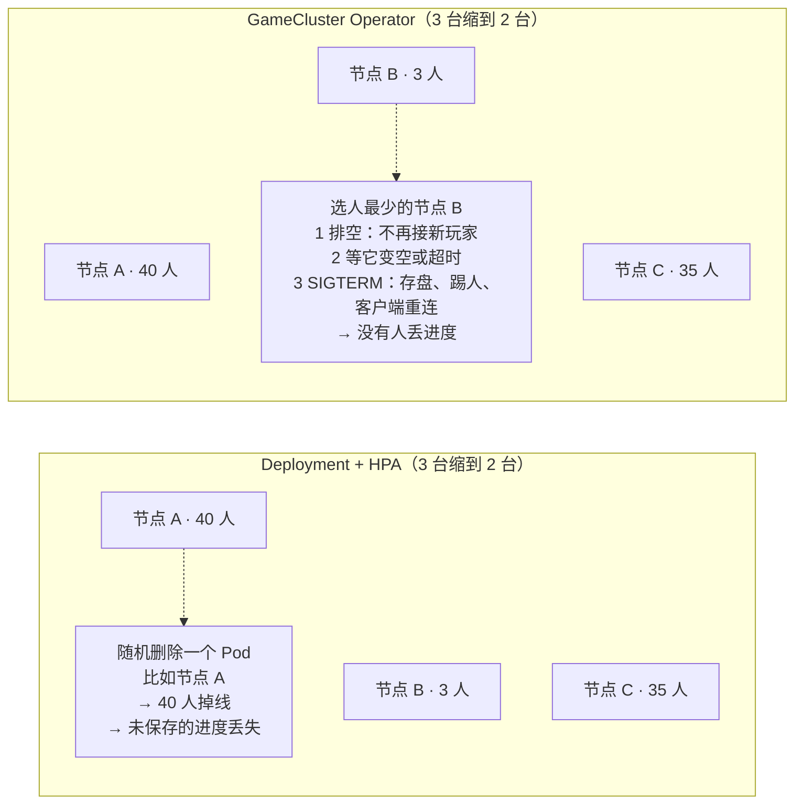
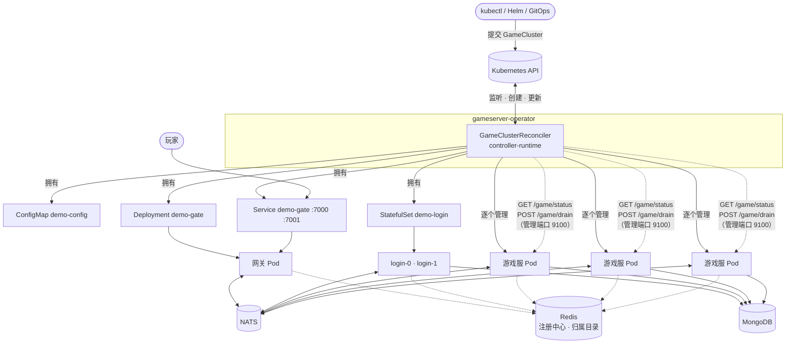
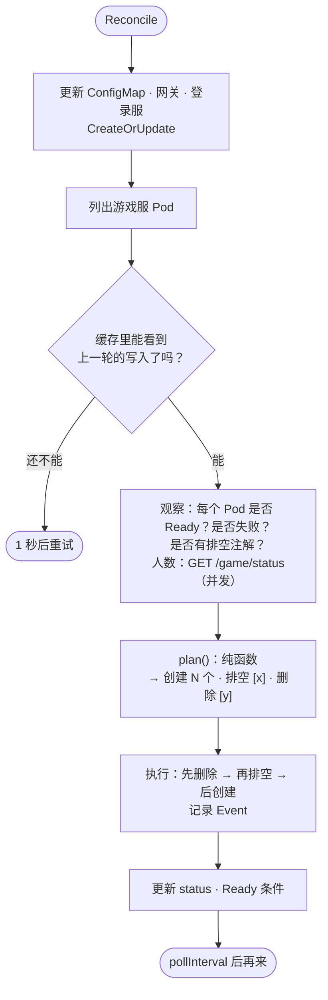
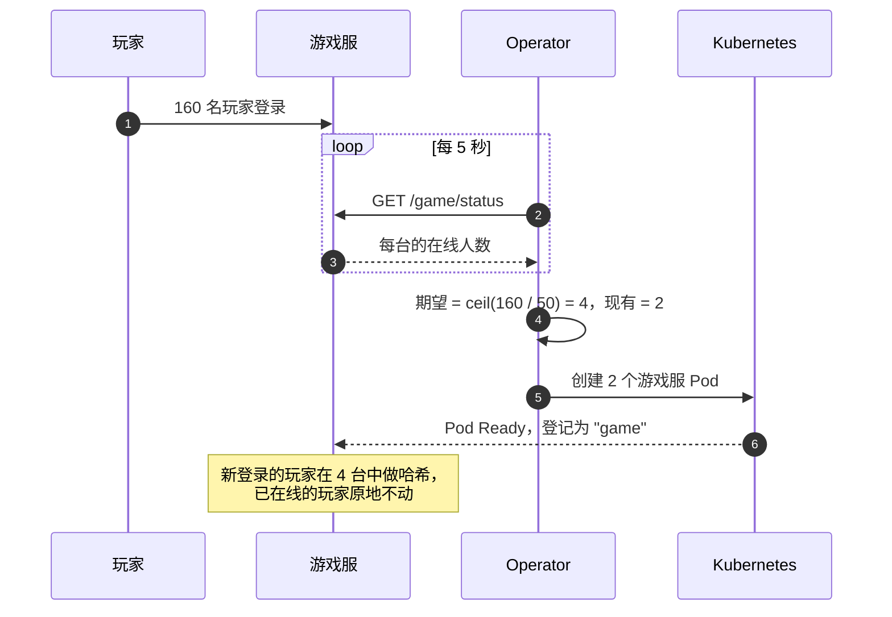
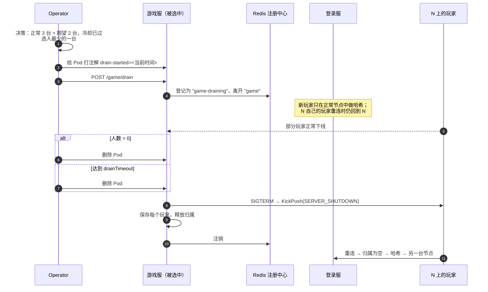
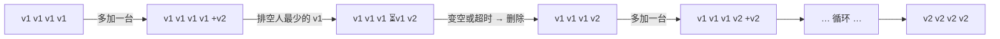
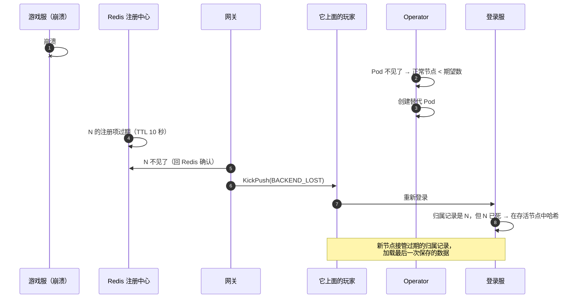

# GameCluster Operator

[English](README.md) · [Helm Chart](../deploy/helm/gameserver/README.zh-CN.md) · [端到端测试](../test/k8s/README.zh-CN.md) · [项目首页](../README.zh-CN.md)


一个用 Go 编写的 Kubernetes Operator。它把本仓库的游戏服务器变成**一个自定义资源**来管理，
并解决原生 Kubernetes 解决不了的问题：游戏服是**有状态**的——玩家活在某台机器的内存里，
所以绝不能随机杀掉节点。

```yaml
apiVersion: gameserver.dev/v1alpha1
kind: GameCluster
metadata:
  name: demo
spec:
  image: gameserver:dev
  infra: { natsURL: "nats://gs-nats:4222", redisAddr: "gs-redis:6379", mongoURI: "mongodb://gs-mongo:27017" }
  gate:  { replicas: 2 }
  login: { replicas: 2 }
  game:
    autoscale: { minReplicas: 2, maxReplicas: 6, targetPlayersPerNode: 50 }
    drainTimeout: 2m
```

```console
$ kubectl get gamecluster -n game
NAME   PHASE     PLAYERS   GAME   DESIRED   DRAINING   GATE   LOGIN   AGE
demo   Running   160       4      4         0          2      2       3m6s
```

## 目录

1. [为什么需要 Operator](#1-为什么需要-operator)
2. [它做了什么](#2-它做了什么)
3. [架构](#3-架构)
4. [调和循环](#4-调和循环)
5. [扩容](#5-扩容)
6. [排空与缩容](#6-排空与缩容)
7. [玩家在线时滚动升级](#7-玩家在线时滚动升级)
8. [节点崩溃时](#8-节点崩溃时)
9. [同一个玩家绝不出现两份](#9-同一个玩家绝不出现两份)
10. [API 参考](#10-api-参考)
11. [本地运行（kind）](#11-本地运行kind)
12. [测试](#12-测试)
13. [设计决策](#13-设计决策)
14. [生产环境注意事项](#14-生产环境注意事项)
15. [代码地图](#15-代码地图)

---

## 1. 为什么需要 Operator

`Deployment` 认为所有 Pod 都一样、可以互相替代。对游戏服来说，这是错的：



| 需求 | Deployment / HPA | 本 Operator |
|---|---|---|
| 决定删**哪一台** | 随机 / 最新的 | 人最少的，优先删旧版本 |
| 删除前让玩家先离开 | 不支持 | 先排空，再等待（`drainTimeout`） |
| 按**在线人数**伸缩 | 需要额外搭建自定义指标管道 | 内置（`targetPlayersPerNode`） |
| 滚动升级不掉线 | Pod 在游戏中途被杀 | 先加一台、再排空一台，循环 |
| 每个登录服唯一的 id（雪花算法） | 做不到 | 使用 StatefulSet 的 Pod 序号 |
| 用一个对象描述整套服务 | 5 个以上的清单 | 一个 `GameCluster` |

## 2. 它做了什么

| 功能 | 实现方式 |
|---|---|
| **创建资源** | ConfigMap（服务器配置）、网关 Deployment + Service、登录服 StatefulSet + headless Service、游戏服 Pod |
| **自动伸缩** | `期望数 = ceil(在线人数 / targetPlayersPerNode)`，限制在 `[min, max]`；扩容立即执行，缩容要等 `scaleDownDelay` |
| **优雅排空** | 给 Pod 打注解 → `POST /game/drain` → 等到 0 人或 `drainTimeout` → 删除（SIGTERM 会存盘并踢掉剩下的人） |
| **滚动升级** | 游戏服 Pod 模板有任何变化（镜像、配置、资源）→ 加一台新节点、排空一台旧节点，循环 |
| **自愈** | 失败或消失的游戏服 Pod 会被补上；网关会踢掉失联节点上的玩家，让他们重连 |
| **可观测** | `kubectl get gc` 列、每个节点的状态、每个决策都记录为 Kubernetes Event、`Ready` 条件 |
| **默认安全** | 非 root、只读根文件系统、去掉所有 capability、seccomp `RuntimeDefault`；每个 Pod 都有探针 |

## 3. 架构



* 网关和登录服是无状态的 → 使用标准控制器（`Deployment`、`StatefulSet`）。
* 游戏服是有状态的 → **由 Operator 直接管理的裸 Pod**，每个 Pod 的名字唯一，同时也是它在游戏集群里的节点 id。
* 所有子对象都通过 owner reference 归属于 `GameCluster`：删掉它，下面的一切都会被删掉。

## 4. 调和循环

每一轮都很短、并且是幂等的。`GameCluster` 或它拥有的任何对象变化时都会触发，
并且至少每隔 `pollInterval`（5 秒）执行一次，用来刷新在线人数。



决策逻辑是一个**纯函数**（`planner.go`），不调用任何 Kubernetes 接口，
所以每条规则都能用普通的表格测试覆盖。规则按顺序是：

| # | 规则 | 原因 |
|---|---|---|
| 1 | 失败的 Pod 直接删除（由第 3 条补上） | 崩溃的 Pod 不会再提供服务 |
| 2 | 排空中的 Pod 在**没人了**或**排空超时**时删除 | 删除 = SIGTERM：节点存盘并踢掉剩下的人，客户端去别处重连 |
| 3 | 正常节点少于期望数 → 立即**创建**差额 | 先保证容量 |
| 4 | 有正常节点还在启动 → **等待** | 新节点没起来之前绝不减少容量 |
| 5 | 正常节点多于期望数 → **排空一台**：优先旧版本，其次人最少的；单纯缩容要等 `scaleDownDelay` | 影响最小，避免来回抖动 |
| 6 | 有旧版本节点且没有正在排空的 → **多创建一台** | 滚动升级期间保持满容量 |

**同一时间最多只排空一台**（本轮刚删除的也算），所以容量最多只会少一台。

**期望机制（Expectations）。** controller-runtime 从 informer 缓存读数据，缓存比写入晚几毫秒。
不加处理的话，"创建 Pod"之后的下一轮可能还看不到这个 Pod，于是又创建一个。
调和器会记住自己的写入（`已创建`、`排空中`、`已删除`），直到缓存反映出来之前都跳过决策（最多等 30 秒）。

## 5. 扩容



端到端测试里的真实事件：

```text
Created game node demo-game-b2c6b: scale up: 0 active, 2 desired (0 players)
Created game node demo-game-9zw97: scale up: 2 active, 3 desired (101 players)
Created game node demo-game-dxrhk: scale up: 3 active, 4 desired (155 players)
```

## 6. 排空与缩容



注解是 Operator 对这个决策的持久化记录：如果 Operator 重启，或者游戏服容器重启后忘了自己在排空，
下一轮看到注解就会重新发送 `POST /game/drain`。

## 7. 玩家在线时滚动升级

修改游戏服 Pod 模板中的任何内容（`image`、配置、`resources`），Operator 会逐台替换所有游戏服，
并且容量始终不低于期望值：



测试中的情况（4 台节点，160 个机器人一直在线，`drainTimeout: 20s`）：

```text
Created  demo-game-nnnpz: rolling update: 4 outdated node(s), add one new node first
Draining demo-game-dxrhk: rolling update: drain outdated node demo-game-dxrhk (0 players)
Removed  demo-game-dxrhk
...
Draining demo-game-vf6r8: rolling update: drain outdated node demo-game-vf6r8 (56 players)
Removed  demo-game-vf6r8                     ← 24 秒后；它的 56 名玩家重连到了 v2 节点
```

多次测试中，4 台节点都在 **52–74 秒**内全部替换完毕，所有机器人都回到了游戏中。

所有角色共用一个镜像，因此网关 Deployment（`maxUnavailable: 0`、`maxSurge: 1`）和登录服 StatefulSet
会同时按各自的标准策略滚动；被替换的网关上的客户端会收到 `KickPush(SERVER_SHUTDOWN)`，并通过另一个网关重连。

## 8. 节点崩溃时

没经过优雅停机就被杀掉的 Pod（OOM、宿主机故障、`kubectl delete --force`）没法通知任何人。
有三套机制兜底：



发现崩溃大约需要 `registry_ttl` + `backend_check_interval`（约 12 秒）。
在这段时间内重新登录的玩家，仍可能被路由到那台死机，于是会再被踢一次，然后落到存活节点上。

崩溃时会丢失上次定时存盘（`save_interval`，30 秒）之后的进度——所有内存型游戏服都是如此；
而优雅的路径（排空、滚动升级、缩容）不会丢任何东西。

## 9. 同一个玩家绝不出现两份

只有保证一个玩家不可能同时加载在两台机器上，在节点之间迁移玩家才是安全的。
游戏服在 Redis 里维护一份**归属目录**（`gs:presence:<uid> → 节点`），详见 [game/presence](../game/presence/README.zh-CN.md)：

* 登录服把在线玩家路由到**持有**它的节点（正常或排空中），只对不在线的玩家做哈希；
* 节点加载玩家之前必须先**获取**归属（Lua 比较并设置），最后一次存盘后再**释放**；
* "这台节点死了"这个结论在采取行动前，一定会**回 Redis 确认**，因为每个进程是分别缓存注册中心各个 key 的。

## 10. API 参考

`gameserver.dev/v1alpha1`，类型 `GameCluster`，简称 `gc`。

| 字段 | 默认 | 说明 |
|---|---|---|
| `spec.image` | —（必填） | 游戏服务器镜像，所有角色共用 |
| `spec.imagePullPolicy` | `IfNotPresent` | |
| `spec.logLevel` | `info` | `debug` · `info` · `warn` · `error` |
| `spec.infra.natsURL` | —（必填） | 消息总线 |
| `spec.infra.redisAddr` | —（必填） | 注册中心和归属目录 |
| `spec.infra.mongoURI` / `mongoDatabase` | — / `game` | 玩家数据库 |
| `spec.gate.replicas` | `2` | 网关 Deployment 副本数 |
| `spec.gate.serviceType` | `ClusterIP` | `NodePort` · `LoadBalancer` |
| `spec.gate.console` | `false` | 在网关 9100 端口提供浏览器测试控制台 |
| `spec.login.replicas` | `1` | 登录服 StatefulSet 副本数（≤ 1024：雪花算法 worker id） |
| `spec.game.replicas` | `2` | 未设置 `autoscale` 时的固定数量 |
| `spec.game.autoscale.minReplicas` / `maxReplicas` | — | 上下限（会校验 min ≤ max） |
| `spec.game.autoscale.targetPlayersPerNode` | — | 每台节点的计划承载人数 |
| `spec.game.autoscale.scaleDownDelay` | `2m` | 缩容前的冷却时间 |
| `spec.game.drainTimeout` | `5m` | 排空时最多等待玩家离开多久 |
| `spec.game.gmEnabled` | `false` | 调试用 GM 命令 |
| `spec.*.resources` | — | 每个角色容器的资源请求/上限 |

| 状态 | 含义 |
|---|---|
| `phase` | `Pending` · `Running` · `Scaling` · `Updating` |
| `players` | 在线玩家数（所有游戏服之和） |
| `gate` / `login` | `{desired, ready}` |
| `game` | `{desired, ready, draining, outdated}` |
| `nodes[]` | `{name, phase: Starting/Active/Draining, players, version, drainStartedAt}` |
| `lastScaleTime` | 最近一次容量变化（用于冷却） |
| `conditions[Ready]` | 网关、登录服、游戏服都达到期望数时为 `True` |

```console
$ kubectl get gc demo -n game -o jsonpath='{range .status.nodes[*]}{.name}{"\t"}{.phase}{"\t"}{.players}{"\n"}{end}'
demo-game-llkjf   Active   0
demo-game-wlzms   Active   55
demo-game-x7fpf   Active   65
```

`llkjf` 是为 120 名玩家刚加的节点：在线玩家原地不动（迁移意味着要重连一次），新节点靠新登录的玩家逐渐填满。

## 11. 本地运行（kind）

```bash
# 1. 工具：Docker、kind、kubectl、Helm
kind create cluster --name gs

# 2. 镜像
docker build -t gameserver:dev -f deploy/Dockerfile .
docker build -t gameserver-operator:dev operator/
kind load docker-image gameserver:dev gameserver-operator:dev --name gs

# 3. Operator + 开发用基础设施 + 一个示例 GameCluster
helm install gs deploy/helm/gameserver -n game --create-namespace
kubectl get gc -n game -w

# 4. 试玩：转发网关端口，打开浏览器控制台
kubectl port-forward -n game svc/demo-gate 7000:7000 7001:7001 &
kubectl port-forward -n game deploy/demo-gate 9100:9100 &
#    http://127.0.0.1:9100/  → 点"运行自检"

# 5. 加压：200 个机器人 → 观察 Operator 加节点
go run ./cmd/robot -addr 127.0.0.1:7000 -n 200 -duration 5m -reconnect
kubectl get events -n game --field-selector involvedObject.kind=GameCluster -w
```

## 12. 测试

| 层级 | 内容 | 位置 |
|---|---|---|
| 决策器单元测试 | 19 个表格用例（扩容/缩容、冷却、排空超时、失败 Pod、人数未知、滚动升级），外加一个完整滚动升级的模拟，断言容量从不下降 | `internal/controller/planner_test.go` |
| 调和器测试 | 针对 controller-runtime 的假 API Server 和假游戏服接口跑完整调和：创建资源、自动扩容 → 排空 → 删除、容器重启后重发排空、排空超时、滚动升级 | `internal/controller/gamecluster_controller_test.go` |
| 游戏服集成测试 | 使用真实 NATS 和 Redis 协议测试扩容 → 排空 → 停服；崩溃节点接管；缓存过期回归测试 | `test/cluster/drain_test.go`、`framework/cluster/registry_redis_test.go` |
| **Kubernetes 端到端** | 真实 kind 集群，160 个机器人全程在线：自动扩容 2 → 4、强杀最忙的节点、所有节点滚动升级、缩回 2 台、核对 MongoDB | [`test/k8s/e2e.sh`](../test/k8s/README.zh-CN.md) |

```bash
cd operator && go test ./...      # 单元 + 调和器测试
bash test/k8s/e2e.sh              # 需要先在集群上安装 Chart
```

最近一次端到端测试（kind，Kubernetes 1.37），160 个机器人在线 6 分钟：

| 检查项 | 结果 |
|---|---|
| 自动扩容 2 → 4 台游戏服 | 160 人上线后 4 秒 |
| 强杀人最多的节点（88 人） | 10 秒内被替换，160 人全部回到线上 |
| 玩家在线时滚动升级 4 台节点 | 74 秒 |
| 机器人：登录失败 / 掉队 | **0 / 0**（被踢 445 次，重连 401 次，59 566 个请求，平均 2.1 毫秒） |
| 机器人离开后缩回 2 台 | 28 秒 |
| MongoDB 中的角色 | 160 / 160 |

## 13. 设计决策

| 决策 | 备选方案 | 原因 |
|---|---|---|
| 游戏服是 Operator 拥有的**裸 Pod** | StatefulSet、Deployment | 只有 Operator 知道每台的人数，也就只有它能决定删哪台；StatefulSet 永远删序号最大的 |
| 通过 **HTTP `/game/status`** 获取人数 | Prometheus + 自定义指标适配器 | 不需要额外组件；同一组接口还能处理"排空" |
| 排空决策记录在 **Pod 注解**上 | 存在内存里 | Operator 重启或切换主节点后仍然有效 |
| **一次只排空一台** | 并行排空 | 容量最多只少一台；容易推理 |
| 纯函数**决策器** | 逻辑写在 Reconcile 里 | 每条规则都是表格测试，不需要 API Server |
| 对自己的写入使用**期望机制** | 完全相信缓存 | 避免缓存延迟导致重复创建或重复排空 |
| 登录服用 **StatefulSet** | Deployment + id 分配服务 | Pod 序号（`apps.kubernetes.io/pod-index`）天然稳定、唯一，正好当雪花算法 worker id |
| 状态用 **Update** 写入 | merge patch | 零值（`players: 0`）也要写进去；冲突时重试 |
| 在 Schema 里做 CRD **校验**（枚举、最小值、CEL `min ≤ max`） | Webhook | 不需要额外维护 TLS 和 Webhook 服务 |

## 14. 生产环境注意事项

* Operator 运行 2 个副本并开启选主（Chart 默认已开启）。
* 使用托管的 NATS / Redis / MongoDB，不要用 Chart 里开发用的单实例。
* 用 `NetworkPolicy` 保护管理端口（9100）：`/game/drain` 没有鉴权。
* 为每个角色设置 `resources`，并把游戏服分散到多个可用区（拓扑分布约束是下一步）。
* 本项目的后续计划：配合 `PodDisruptionBudget` 的驱逐流程、为 Operator 决策暴露 Prometheus 指标、对 `Ready=False` 告警。

## 15. 代码地图

```
operator/
├── api/v1alpha1/
│   ├── gamecluster_types.go       spec、status、kubebuilder 标记（校验、打印列）
│   └── zz_generated.deepcopy.go   由 controller-gen 生成
├── internal/controller/
│   ├── gamecluster_controller.go  Reconcile：创建资源、观察、执行决策、状态、期望机制
│   ├── planner.go                 纯函数：伸缩 / 排空 / 滚动升级规则
│   ├── resources.go               ConfigMap、Deployment、StatefulSet、Service、Pod 的构造
│   └── nodeclient.go              调用 /game/status 和 /game/drain 的 HTTP 客户端
├── cmd/main.go                    manager、选主、健康探针、指标
├── config/crd · config/rbac       生成的 CRD 和 ClusterRole
└── Dockerfile                     静态二进制 + distroless，非 root
```

修改 API 后重新生成：

```bash
cd operator
go run sigs.k8s.io/controller-tools/cmd/controller-gen@v0.23.0 object crd rbac:roleName=gameserver-operator \
  paths=./api/v1alpha1 paths=./internal/controller \
  output:crd:artifacts:config=config/crd output:rbac:artifacts:config=config/rbac
cp config/crd/*.yaml ../deploy/helm/gameserver/crds/
```
