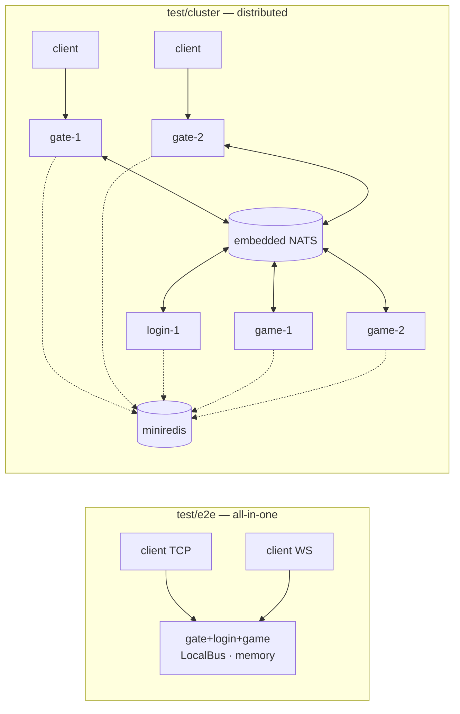

# test — integration tests

[中文](README.zh-CN.md)

Unit tests live next to their packages. This directory holds tests that start
**whole servers** and talk to them through real sockets, exactly like a game client.



## test/e2e

| Test | Covers |
|---|---|
| `TestFullGameFlow` | auth guard, account validation, heartbeat, login over TCP and WebSocket, mutual AOI visibility, starter bag, item use with level-up and pushes, unusable/insufficient items, world chat, movement push, anti-teleport, GM, wrong password, duplicate login kick, stale session ignored, save + unload on disconnect, leave push |
| `TestManyConcurrentPlayers` | 50 concurrent clients logging in and moving |
| `TestShutdownSavesPlayers` | `App.Stop` sends `KickPush(SERVER_SHUTDOWN)` and persists players |

## test/cluster

| Test | Covers |
|---|---|
| `TestDistributedCluster` | registry discovery via Redis protocol, players spread over two game nodes, world chat across nodes and gates, re-login through another gate lands on the same game node and kicks the old session, save to shared store |
| `TestLoginUnavailableWithoutGameNodes` | `SERVICE_UNAVAILABLE` when no game node is registered |
| `TestScaleOutDrainAndShutdown` | what the operator does to a node: online players stay put when a node is added, `POST /game/drain` stops new assignments, players on the draining node still reconnect to it, `Stop` kicks + saves, everyone reconnects to the remaining node with progress intact |
| `TestGateKicksSessionsOfCrashedNode` | a node vanishes from the registry without a graceful stop: the gate kicks its sessions with `BACKEND_LOST`, re-login takes over the stale presence entry |

Every node in `test/cluster` has its own NATS connection and registry client,
so the code paths are identical to separate processes. Storage is shared via
`bootstrap.WithRepos` (stand-in for MongoDB).

## test/webconsole — browser test (headless Chrome)

Builds the server image, starts it, and drives the [web console](../game/webconsole/README.md)
with Puppeteer exactly like a user: 28 checks covering the one-click self-test,
the manual flow through buttons, two browsers meeting on the map and chatting,
movement by keyboard and map click, duplicate-login kick and view reset,
readable error toast, password masking, language switch, 390 px mobile layout
and zero JavaScript errors. Screenshots and `results.json` land in
`test/webconsole/out/`.

```bash
docker compose -f test/webconsole/compose.yml up --build --abort-on-container-exit --exit-code-from browser
docker compose -f test/webconsole/compose.yml down
```

## test/k8s — operator on Kubernetes

[`test/k8s/e2e.sh`](k8s/README.md) runs on a real cluster (kind) with 160
robots online: autoscale 2 → 4 game nodes, force-kill the busiest node, rolling
update of every node, scale back to 2, verify MongoDB.

## Commands

```bash
go test ./test/...
go test -count=10 ./test/...       # flakiness check
go test -run TestDistributedCluster -v ./test/cluster/
```
