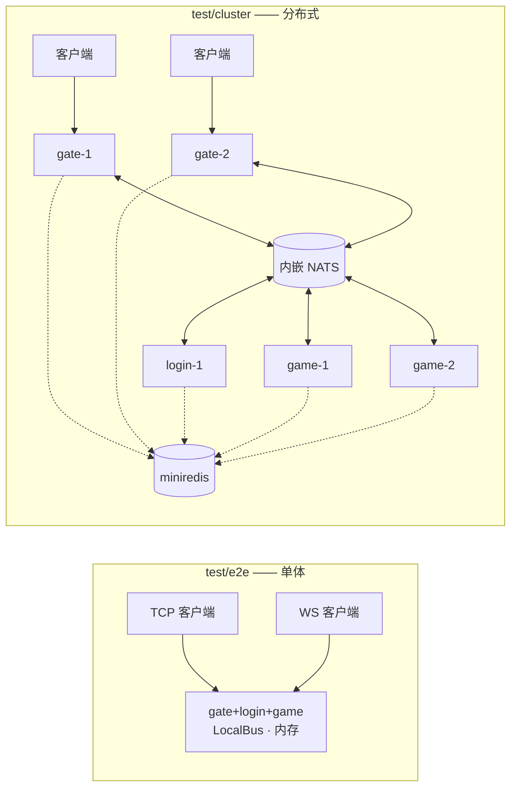

# test —— 集成测试

[English](README.md)

单元测试和各自的包放在一起。这个目录里的测试会启动**完整的服务器**，并像真正的游戏客户端一样通过真实 socket 与之通信。



## test/e2e

| 测试 | 覆盖内容 |
|---|---|
| `TestFullGameFlow` | 鉴权拦截、账号校验、心跳、TCP 与 WebSocket 登录、AOI 互相可见、新手背包、使用道具升级并推送、不可用/数量不足的道具、世界聊天、移动推送、防瞬移、GM、密码错误、顶号踢人、忽略过期会话、断线存盘并卸载、离开推送 |
| `TestManyConcurrentPlayers` | 50 个并发客户端登录并移动 |
| `TestShutdownSavesPlayers` | `App.Stop` 发送 `KickPush(SERVER_SHUTDOWN)` 并持久化玩家 |

## test/cluster

| 测试 | 覆盖内容 |
|---|---|
| `TestDistributedCluster` | 通过 Redis 协议进行服务发现、玩家分布在两个游戏节点、跨节点跨网关的世界聊天、从另一个网关重登会落到同一游戏节点并踢掉旧会话、保存到共享存储 |
| `TestLoginUnavailableWithoutGameNodes` | 没有注册游戏节点时返回 `SERVICE_UNAVAILABLE` |

`test/cluster` 中每个节点都有自己的 NATS 连接和注册中心客户端，因此代码路径与独立进程完全一致。
存储通过 `bootstrap.WithRepos` 共享（代替 MongoDB）。

```bash
go test ./test/...
go test -count=10 ./test/...       # 检查是否偶发失败
go test -run TestDistributedCluster -v ./test/cluster/
```
