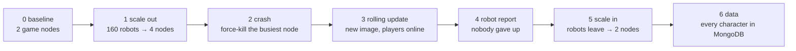

# test/k8s — end-to-end test on Kubernetes

[中文](README.zh-CN.md) · [Operator](../../operator/README.md)

`e2e.sh` drives a real Kubernetes cluster (kind is enough) with the operator,
the game server and a Job of robots that stay online the whole time. It checks
what an SRE cares about: capacity follows load, a crash heals itself, an
upgrade does not drop players, and no data is lost.



| Step | Pass condition |
|---|---|
| 0 Baseline | `GameCluster` `Running` with `minReplicas` (2) game nodes; test settings applied (`drainTimeout 20s`, `scaleDownDelay 30s`, 50 players per node) |
| 1 Scale out | 160 robots online; the operator reaches 4 ready game nodes |
| 2 Crash | the node with the most players is force-deleted (no graceful stop); it is replaced and its players are back online |
| 3 Rolling update | `spec.image` changed with players online → every node replaced (no old version left), 4 ready, 160 players back |
| 4 Robots | the robot Job succeeds: no login failure, every disconnected robot got back in (`gave up: 0`) |
| 5 Scale in | robots leave → drained back to 2 nodes, phase `Running` |
| 6 Data | MongoDB holds a character for every robot |

## Run

```bash
# once: cluster, images, chart
kind create cluster --name gs
docker build -t gameserver:dev -f deploy/Dockerfile .
docker build -t gameserver-operator:dev operator/
echo 'FROM gameserver:dev' | docker build --label v=2 -t gameserver:e2e-v2 -   # the "new version"
kind load docker-image gameserver:dev gameserver:e2e-v2 gameserver-operator:dev --name gs
helm install gs deploy/helm/gameserver -n game --create-namespace

# the test (~8 minutes)
bash test/k8s/e2e.sh
```

Environment: `NS` (default `game`), `GC` (`demo`), `ROBOTS` (`160`), `OUT`
(`test/k8s/out`: robot report, operator events, final `GameCluster` YAML).
For a clean re-run: `helm uninstall gs -n game && kubectl delete ns game`, then install again.

## Result

Last run (kind, Kubernetes 1.37, one node, Docker Desktop on Windows):

```text
== 0. Baseline ==
  PASS  cluster Running with 2 game nodes (6s)
  game nodes: demo-game-8gn97 demo-game-nxhlq
== 1. Scale out under load ==
  PASS  160 players online (9s)
  PASS  autoscaled to 4 ready game nodes (4s)
4 ready / 4 desired, players=160
== 2. Node crash ==
  force-deleting demo-game-nxhlq with 88 players (no graceful stop, like a kernel panic)
  PASS  crashed node replaced (10s)
  players right after the crash: 160
  PASS  its players reconnected (160 online) (0s)
== 3. Rolling update with players online ==
  new image gameserver:e2e-v2 (must already be loaded into the cluster)
  PASS  phase Updating (0s)
  PASS  all game nodes replaced (74s)
  PASS  players back on the new nodes (0s)
4 ready / 4 desired, players=160
== 4. Robot report ==
  PASS  robots finished (270s)
==== robot report (6m3.274s) ====
robots:       160
login ok:     561
login failed: 0
requests:     59566 (errors 301)
avg latency:  2.137075ms
pushes recv:  1180546
kicked:       445
reconnects:   401
gave up:      0
  PASS  every robot logged in and every disconnected robot got back in
== 5. Scale in after players leave ==
  PASS  players gone (1s)
  PASS  drained back to 2 game nodes (28s)
== 6. Data ==
  PASS  160 robot characters saved in MongoDB
ALL 13 CHECKS PASSED
```
