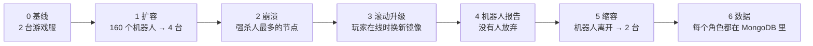

# test/k8s —— Kubernetes 端到端测试

[English](README.md) · [Operator](../../operator/README.zh-CN.md)

`e2e.sh` 在一个真实的 Kubernetes 集群（kind 就够）上，驱动 Operator、游戏服务器，
以及一个全程在线的机器人 Job。它检查的是 SRE 最关心的事：容量跟着负载走、崩溃能自愈、
升级不掉线、数据不丢失。



| 步骤 | 通过条件 |
|---|---|
| 0 基线 | `GameCluster` 为 `Running`，游戏服数量为 `minReplicas`（2）；应用测试参数（`drainTimeout 20s`、`scaleDownDelay 30s`、每台 50 人） |
| 1 扩容 | 160 个机器人在线；Operator 扩到 4 台就绪的游戏服 |
| 2 崩溃 | 强制删除人最多的节点（不经过优雅停机）；它会被替换，它上面的玩家重新上线 |
| 3 滚动升级 | 玩家在线时修改 `spec.image` → 所有节点都被替换（不剩旧版本）、4 台就绪、160 人回到游戏 |
| 4 机器人 | 机器人 Job 成功：没有登录失败，每个掉线的机器人都重新回到了游戏（`gave up: 0`） |
| 5 缩容 | 机器人离开 → 排空回到 2 台，状态 `Running` |
| 6 数据 | MongoDB 中每个机器人都有角色数据 |

## 运行

```bash
# 只需一次：集群、镜像、Chart
kind create cluster --name gs
docker build -t gameserver:dev -f deploy/Dockerfile .
docker build -t gameserver-operator:dev operator/
echo 'FROM gameserver:dev' | docker build --label v=2 -t gameserver:e2e-v2 -   # 当作"新版本"
kind load docker-image gameserver:dev gameserver:e2e-v2 gameserver-operator:dev --name gs
helm install gs deploy/helm/gameserver -n game --create-namespace

# 运行测试（约 8 分钟）
bash test/k8s/e2e.sh
```

环境变量：`NS`（默认 `game`）、`GC`（`demo`）、`ROBOTS`（`160`）、`OUT`
（`test/k8s/out`：机器人报告、Operator 事件、最终的 `GameCluster` YAML）。
想干净地重跑：`helm uninstall gs -n game && kubectl delete ns game`，然后重新安装。

## 结果

最近一次运行（kind，Kubernetes 1.37，单节点，Windows 上的 Docker Desktop）：

```text
== 0. Baseline ==
  PASS  cluster Running with 2 game nodes (6s)
  game nodes: demo-game-8gn97 demo-game-nxhlq
== 1. Scale out under load ==
  PASS  160 players online (9s)
  PASS  autoscaled to 4 ready game nodes (4s)
4 ready / 4 desired, players=160
== 2. Node crash ==
  force-deleting demo-game-nxhlq with 88 players (no graceful stop, like a kernel panic)
  PASS  crashed node replaced (10s)
  players right after the crash: 160
  PASS  its players reconnected (160 online) (0s)
== 3. Rolling update with players online ==
  new image gameserver:e2e-v2 (must already be loaded into the cluster)
  PASS  phase Updating (0s)
  PASS  all game nodes replaced (74s)
  PASS  players back on the new nodes (0s)
4 ready / 4 desired, players=160
== 4. Robot report ==
  PASS  robots finished (270s)
==== robot report (6m3.274s) ====
robots:       160
login ok:     561
login failed: 0
requests:     59566 (errors 301)
avg latency:  2.137075ms
pushes recv:  1180546
kicked:       445
reconnects:   401
gave up:      0
  PASS  every robot logged in and every disconnected robot got back in
== 5. Scale in after players leave ==
  PASS  players gone (1s)
  PASS  drained back to 2 game nodes (28s)
== 6. Data ==
  PASS  160 robot characters saved in MongoDB
ALL 13 CHECKS PASSED
```
